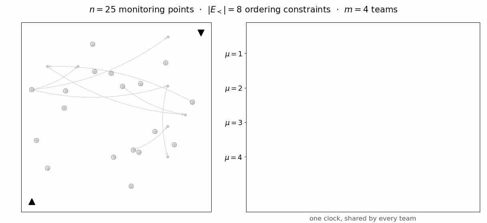
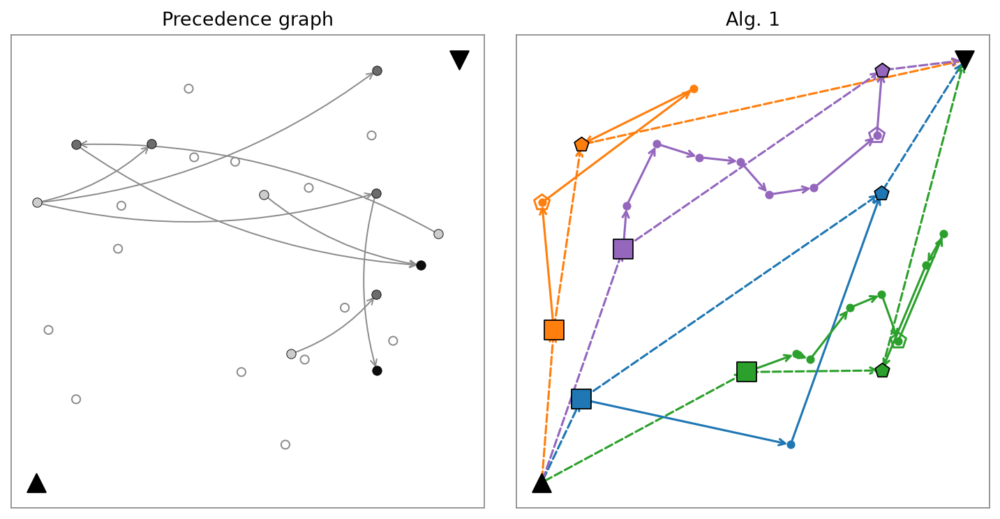
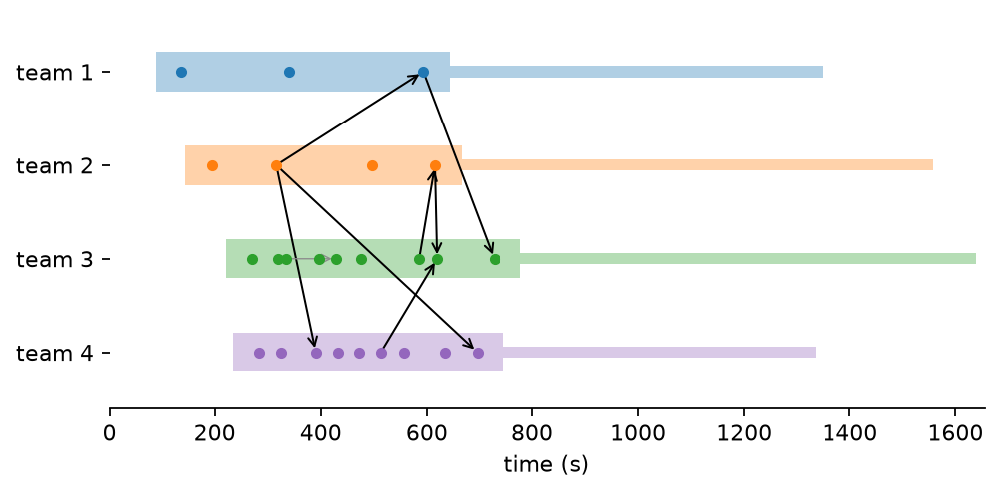

# Robust and Scalable UAV-UGV Planning for Aerial Monitoring under Energy and Precedence Constraints

[](https://arxiv.org/abs/2610.12670)
[](https://doi.org/10.48550/arXiv.2610.12670)

Python implementation of Alg. 1, a polynomial-time planner for teams of
unmanned aerial and ground vehicles that must visit monitoring points in a
required order, and of the baselines it is compared against in the paper.

Developed at the [Multi-Agent Robotics and Autonomy Lab](https://github.com/Multi-Agent-Robotics-and-Autonomy-Lab), Northeastern University.

<p align="center">
  
</p>

## Abstract

> We consider planning for unmanned aerial vehicle (UAV) and unmanned ground
> vehicle (UGV) teams in aerial monitoring missions with ordering requirements
> on the monitoring points to be visited by the UAV. The system consists of
> multiple UAV-UGV teams, each comprising one UAV and one UGV. UAV energy
> limitations are modeled through endurance, defined as the maximum flight time
> on a full battery. The UGVs serve as mobile charging stations and transport
> the UAVs between consecutive aerial tours. Given a set of monitoring points
> subject to ordering constraints and the teams' initial and terminal
> positions, the objective is to minimize mission completion time while
> satisfying UAV energy limits and the required visit order under bounded
> travel-time disturbances that may arise during execution. Unlike prior work,
> the plan jointly determines vehicle routes and their timing, allowing teams
> to slow down as needed to satisfy the ordering constraints. We develop a
> polynomial-time algorithm that generates efficient solutions to the
> underlying NP-hard planning problem. We establish feasibility guarantees,
> characterize the algorithm's computational complexity, and evaluate its
> performance via numerical comparisons.

<p align="center">
  <picture>
    <source media="(prefers-color-scheme: dark)" srcset="docs/plan_dark.png">
    
  </picture>
</p>

*Left: 25 monitoring points and their precedence graph, shaded from sources
(faint) to sinks (strong); hollow points carry no ordering requirement. Right:
the plan Alg. 1 returns for four teams. Squares are release points, filled
pentagons collect points, hollow pentagons feasible collect points that were
not taken; solid lines are UAV flights, dashed lines UGV routes, and triangles
the shared start and finish. The mission is the one in Fig. 1 of the paper:
Table I parameters except a precedence density d = 0.3 and a UGV speed
s<sub>g</sub> = 10 m/s.*

<p align="center">
  <picture>
    <source media="(prefers-color-scheme: dark)" srcset="docs/timeline_dark.png">
    
  </picture>
</p>

*The same plan in time. Wide bars: the UAV is airborne; thin bars: it rides
the UGV and recharges. Dots are visit times and arrows are precedence edges,
so the ordering holds exactly when every arrow points right. Most edges join
points on different teams.*

## How it works

A mission has n monitoring points in the air, a precedence graph over them (a
DAG whose edge (p, q) requires p to be visited before q), and m teams, each
one UAV and one UGV with a start and a finish position on the ground. The UAV
can fly at most τ̄<sub>a</sub> seconds on a battery. It flies tours: it takes
off from the UGV at a release point, visits some monitoring points, and lands
on the UGV at a collect point, which then carries it, recharging, to the next
release point.

A plan is the pair (X, Θ) of Section II. For each team, X is an n × (n+2)
matrix whose rows are tours (release point, visited points, collect point),
and Θ gives the duration of every leg. A duration may exceed the fastest
travel time, so a team can slow down instead of rerouting to respect the
ordering. The objective is the makespan, the largest team execution time of
Eq. (2), subject to the endurance limit with margins δ<sub>a</sub> and
δ<sub>g</sub> and to every precedence edge being separated in time by at least
δ<sub>o</sub>. The margins keep the plan feasible under bounded travel-time
disturbances.

Alg. 1 builds the assignment, the visit order, the tours and their timing
together, one point per iteration:

1. For every team μ and every ready point q (one whose predecessors are all
   placed), compute the earliest permitted visit time
   w<sub>q</sub> = max<sub>p</sub> (t<sub>p</sub> + δ<sub>o</sub>) over q's
   predecessors.
2. Try to append q to μ's open tour, with an airborne wait if q would
   otherwise be reached before w<sub>q</sub>. Keep the candidate collect
   points (the ground projections of the tour's points and of q) that keep
   both the UAV's flight and the UGV's drive within the endurance limit.
3. If no candidate survives, or μ has no tour yet, close the open tour at the
   collect point that minimises the time to land, recharge and drive to the
   new release point π(q), and open a new tour there, with a ground wait if
   needed.
4. Commit the pair (μ, q) that keeps the largest team cost smallest, where a
   team's cost is the visit time of its last point; ties are broken
   lexicographically.
5. Once every point is placed, land each team's last tour at the collect
   point that minimises its airborne time plus the drive to its finish.

Because each visit is timed against the already fixed visit times of its
predecessors, points joined by a precedence edge can be served by different
teams, so even a dense ordering can be shared by all of them. If every point admits a
feasible single-point tour (Assumption 1), Alg. 1 returns a feasible plan in
O(mn³) time (Theorem 1). [`alg1.py`](uav_ugv_precedence/alg1.py) follows the
pseudocode line by line and cites its line numbers.

## Install

```bash
git clone https://github.com/Multi-Agent-Robotics-and-Autonomy-Lab/precedence-aware-uav-ugv-planning.git
cd precedence-aware-uav-ugv-planning
pip install -e .              # numpy, matplotlib
pip install -e ".[gurobi]"    # optional, for branch and cut
```

Python 3.9 or newer. Branch and cut needs [Gurobi](https://www.gurobi.com).
The `gurobipy` package from pip ships a size-limited licence that covers up to
three points with one team or two points with two teams; larger instances need
a full licence (free for academic use).

## Quick start

```python
from uav_ugv_precedence import Params, alg1, make_instance, plotting

instance = make_instance(n=25, m=4, d=0.5, seed=0)   # the generator of Section IV
result = alg1.solve(instance, Params())              # Table I parameters

print(result.feasible, result.makespan)   # (3b)-(3k) hold; makespan of Eq. (2)
plotting.figure(instance, result).savefig("plan.png")
```

Every planner has the same `solve(instance, params)` and returns a `Result`:
the plan (`result.plan.X`, `Theta_a`, `Theta_g`, `Theta_ga`, `theta_s`,
`theta_f`, shaped as in Section II), the makespan and team times of Eq. (2),
the visit times t<sub>p</sub>, the list of violated constraints (empty when
the plan is feasible) and the planner's runtime. Missions can also be built by
hand with `Instance(points, edges, starts, finishes)`, and the travel-time
model, recharge function and ground projection are methods of `Params` that a
subclass can replace.

## Examples

Each script runs in a few seconds and saves a figure to `outputs/`.

| Script | Shows |
|---|---|
| [`alg1_quickstart.py`](examples/alg1_quickstart.py) | Alg. 1 on a random mission: tours per team and the plan figure |
| [`alg1_robust_margins.py`](examples/alg1_robust_margins.py) | The same mission with and without robustness margins, checked on the returned plan |
| [`alg1_dense_precedence.py`](examples/alg1_dense_precedence.py) | A precedence graph that is one connected component, still split across all teams |
| [`alg1_custom_instance.py`](examples/alg1_custom_instance.py) | A hand-built mission (perimeter before interior), per-team start and finish, and a battery-swap recharge model |
| [`decoupled_baseline.py`](examples/decoupled_baseline.py) | The decoupled precedence baseline |
| [`simulated_annealing.py`](examples/simulated_annealing.py) | Simulated annealing on a tiny mission |
| [`branch_and_cut.py`](examples/branch_and_cut.py) | Branch and cut on a tiny mission (needs `gurobipy`) |

```bash
python examples/alg1_quickstart.py
```

## Planners

| Planner | Module | Approach | Instance size |
|---|---|---|---|
| **Alg. 1** | [`alg1.py`](uav_ugv_precedence/alg1.py) | Builds assignment, order, tours and timing together; polynomial, O(mn³) | Any |
| Decoupled precedence baseline | [`decoupled.py`](uav_ugv_precedence/decoupled.py) | Each weakly connected component of the precedence graph to one team by Longest Processing Time, then Alg. 1's tour cutting and timing | Any |
| Simulated annealing | [`annealing.py`](uav_ugv_precedence/annealing.py) | Local search over the matrices (X, Θ) with penalties for violated constraints and a logarithmic cooling schedule, from a feasible round-robin start | Tiny |
| Branch and cut | [`branch_and_cut.py`](uav_ugv_precedence/branch_and_cut.py) | Problem (3) as a mixed-integer quadratically constrained program, solved by Gurobi to a 5% optimality gap; release and collect points anywhere on the ground | Tiny |

## Parameter defaults

`Params()` and `make_instance()` default to Table I of the paper.

| Parameter | Symbol | Default |
|---|---|---|
| Environment size | x̄, ȳ | 4000 m |
| Monitoring altitude | z | 100 m |
| Start and finish of every team | p<sub>s</sub>, p<sub>f</sub> | (0, 0, 0), (4000, 4000, 0) |
| Precedence density (edges per point) | d | 0.5 |
| Shortest path | ℓ(u, v) | ‖u − v‖₂ |
| UAV cruise and climb speed | s<sub>H</sub>, s<sub>V</sub> | 10 m/s, 2 m/s |
| UGV speed | s<sub>g</sub> | 2.5 m/s |
| UAV fastest travel time | θ<sub>a</sub>(u, v) | ℓ<sub>H</sub>(u, v)/s<sub>H</sub> + ℓ<sub>V</sub>(u, v)/s<sub>V</sub> |
| UGV fastest travel time | θ<sub>g</sub>(u, v) | ℓ(u, v)/s<sub>g</sub> |
| Recharge time | τ<sub>c</sub> | γ · max(τ<sub>a</sub>, τ<sub>g</sub>) |
| Recharge ratio | γ | 1 |
| Maximum flight time | τ̄<sub>a</sub> | 600 s |
| Energy robustness margins | δ<sub>a</sub>, δ<sub>g</sub> | 0 s |
| Ordering robustness margin | δ<sub>o</sub> | 0 s |

## Repository layout

```
uav_ugv_precedence/
    problem.py          parameters, instances, plan (X, Θ), Eq. (2), visit times, checks of (3b)-(3k)
    alg1.py             Alg. 1
    decoupled.py        decoupled precedence baseline
    annealing.py        simulated annealing
    branch_and_cut.py   branch and cut (Gurobi)
    plotting.py         precedence graph, plan in space, plan in time
examples/               one script per planner, and a few more for Alg. 1
tests/                  pytest suite
docs/                   README figures; make_figures.py redraws the PNGs (the GIF is drawn separately)
```

## Tests

```bash
pip install pytest
pytest
```

The branch-and-cut tests are skipped when `gurobipy` is not installed.

## Citation

```bibtex
@article{er2026robust,
  title   = {Robust and Scalable {UAV-UGV} Planning for Aerial Monitoring under Energy and Precedence Constraints},
  author  = {Er, Cahit Ikbal and Yaz{\i}c{\i}o{\u{g}}lu, Yasin},
  journal = {arXiv preprint arXiv:2610.12670},
  year    = {2026},
  doi     = {10.48550/arXiv.2610.12670}
}
```
